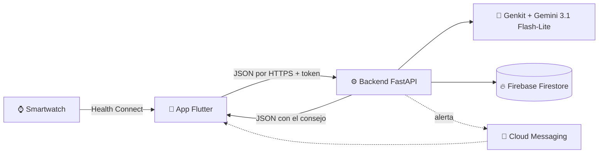
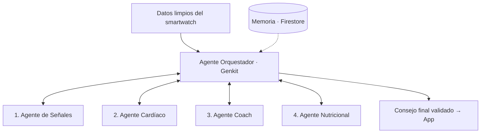
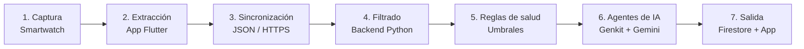

# BioForm AI · Asesor Fit Digital con integración de smartwatch

**Curso:** PROJECT-IIS2026 · Advanced Programming
**Universidad:** Yachay Tech University · 2026
**Equipo:** Lucas Emilia, Salazar Lady y Tuquerres Rommel
**Estado:** diseño completo del producto y del MVP (Alpha/Beta Android)

> ⚠️ BioForm AI es una aplicación de **bienestar**, no un dispositivo médico. No realiza diagnósticos; ante cualquier alerta recomienda consultar a un profesional de la salud.

---

## Tabla de contenido

1. [Descripción del proyecto](#1-descripción-del-proyecto)
2. [Business Model Canvas](#2-business-model-canvas)
3. [Stack tecnológico](#3-stack-tecnológico)
4. [Firebase: servicios del backend](#4-firebase-servicios-del-backend)
5. [Arquitectura de software](#5-arquitectura-de-software)
6. [Arquitectura multi-agente de IA](#6-arquitectura-multi-agente-de-ia)
7. [Modelos de IA por tarea](#7-modelos-de-ia-por-tarea)
8. [Framework de agentes y modelo de IA](#8-framework-de-agentes-y-modelo-de-ia)
9. [Viabilidad comercial](#9-viabilidad-comercial)
10. [Producto mínimo viable (MVP)](#10-producto-mínimo-viable-mvp)
11. [Diagrama de caso de uso](#11-diagrama-de-caso-de-uso)
12. [Pipeline de datos](#12-pipeline-de-datos)
13. [Estado del arte](#13-estado-del-arte)
14. [Riesgos y consideraciones técnicas](#14-riesgos-y-consideraciones-técnicas)
15. [Hoja de ruta](#15-hoja-de-ruta)
16. [Entregables realizados](#16-entregables-realizados)
17. [Referencias](#17-referencias)

---

## 1. Descripción del proyecto

BioForm AI es una aplicación móvil para Android que funciona como un **asesor fitness digital**. Lee los datos biométricos del smartwatch del usuario (frecuencia cardíaca, pasos, sueño, calorías, acelerómetro y giroscopio) y genera consejos personalizados de entrenamiento, alimentación y recuperación.

**Problema.** Millones de personas usan un reloj inteligente, pero pocas saben interpretar sus datos y convertirlos en decisiones: si conviene entrenar fuerte o descansar, qué comer después de una sesión intensa o si su frecuencia en reposo es motivo de preocupación.

**Solución.** BioForm AI combina datos del smartwatch, reglas biomédicas de seguridad y un sistema multi-agente de IA para entregar, en menos de un minuto, un consejo personalizado de entrenamiento y nutrición.

---

## 2. Business Model Canvas

| Bloque | Contenido |
| :--- | :--- |
| **Segmentos de clientes** | Adultos que buscan cuidar su salud y llevar una vida activa; deportistas y usuarios de gimnasio que quieren rendir más y evitar lesiones. |
| **Propuesta de valor** | Asesor Fit Digital (consejos antes, durante y después del entrenamiento); nutrición y recuperación según calorías quemadas; aprovechamiento de los datos del smartwatch; seguridad y privacidad de los datos biométricos. |
| **Canales** | Google Play (Alpha/Beta en Android). |
| **Relación con los clientes** | Cuenta personal con historial de métricas y recomendaciones; comunidad para compartir progreso. |
| **Flujos de ingreso** | Modelo *freemium*: publicidad en la versión gratuita y versión premium mediante compras dentro de la app o descarga de pago. |
| **Recursos clave** | Modelos de IA para datos biométricos; desarrolladores (Ingeniería en TIC); ingenieros biomédicos. |
| **Actividades clave** | I+D de modelos de IA; marketing en redes y comunidades fitness; validación de consejos de entrenamiento y nutrición. |
| **Aliados clave** | Health Connect, Google Fit, Apple Health y Garmin API; fisioterapeutas, entrenadores y nutricionistas. |
| **Estructura de costos** | Google Play Console (pago único); servidores en la nube y bases de datos; marketing; talento humano; uso de la API de Gemini. |

**Sobre el modelo de ingresos:**
- La publicidad (por ejemplo con AdMob) nunca se muestra en pantallas de alertas de salud, y los datos biométricos **no** se usan para personalizar anuncios.
- La suscripción premium es la opción recomendada, porque los costos de la IA son recurrentes.
- Las alertas cardíacas son siempre gratuitas.
- El MVP no incluye pagos; primero se valida la utilidad de los consejos.

---

## 3. Stack tecnológico

| Capa | Tecnología | Justificación |
| :--- | :--- | :--- |
| **Frontend (app móvil)** | Flutter (Dart) | App nativa de alto rendimiento para Android; el mismo código escala a iOS. |
| **Integración de sensores** | Health Connect | API oficial de Google que unifica FC, pasos, sueño y datos de actividad de Garmin, Fitbit y Wear OS. |
| **Backend · lógica e IA** | Python + FastAPI | Python es el estándar en IA y datos; FastAPI es rápido y fácil de conectar con Flutter. |
| **Backend · servicios de datos** | Firebase (Auth + Firestore + Cloud Messaging) | Login, base de datos NoSQL con modo sin conexión y notificaciones push; plan gratuito Spark. |
| **Inteligencia artificial** | Genkit + Gemini 3.1 Flash-Lite + Scikit-learn | Genkit orquesta los agentes, Gemini redacta los consejos y Scikit-learn procesa las señales de FC. |
| **Herramientas** | GitHub · Cursor / Claude Code · Render | Control de versiones, programación asistida por IA y hosting gratuito del backend. |

**Frontend y backend.** El frontend es la app en Flutter, lo único que el usuario ve. El backend tiene **dos partes que trabajan juntas**:
- **FastAPI (Python)** es nuestro propio servidor: filtra las señales, aplica las reglas de salud y ejecuta los agentes de IA.
- **Firebase** son servicios de Google: identifica al usuario, guarda los datos y envía las notificaciones.

---

## 4. Firebase: servicios del backend

| Servicio | Uso en BioForm AI |
| :--- | :--- |
| **Firebase Authentication** | Registro e inicio de sesión con correo o cuenta de Google. Cada usuario tiene un UID; el backend verifica su token con el Firebase Admin SDK. |
| **Cloud Firestore** | Base de datos NoSQL de documentos y colecciones, con persistencia sin conexión integrada (ideal para gimnasios sin señal). |
| **Cloud Messaging (FCM)** | Notificaciones push para avisar de una frecuencia cardíaca en reposo fuera de rango, aunque la app esté cerrada. |
| **Security Rules** | Cada usuario solo puede leer y escribir sus propios documentos. |

**Modelo de datos del MVP (Firestore):**

```text
users/{uid}                  → perfil y línea base de FC en reposo
users/{uid}/metrics/{date}   → resumen diario: FC en reposo, pasos, sueño, calorías, actividad
users/{uid}/advice/{id}      → consejos generados y alertas emitidas
```

> **Decisión de diseño:** Firestore cobra por lectura y escritura, por eso se guarda **un resumen diario por usuario** y no cada muestra del sensor.

---

## 5. Arquitectura de software

Modelo **cliente-servidor con API REST**. El teléfono no ejecuta la IA: recolecta los datos, llama al backend de forma segura y muestra el resultado.



**Flujo de una petición:**
1. El smartwatch registra FC, pasos, calorías, sueño y movimiento.
2. La app Flutter lee los datos con Health Connect y los empaqueta.
3. La app envía un JSON por HTTPS al backend.
4. FastAPI valida los datos, aplica las reglas y ejecuta los agentes de Genkit, que llaman a Gemini.
5. Las métricas y el consejo se guardan en Firestore.
6. El backend devuelve un JSON con el consejo, que la app muestra como texto y gráficos.

---

## 6. Arquitectura multi-agente de IA

Un **agente orquestador** construido con Genkit reparte el trabajo entre agentes especializados (patrón ReAct) y une sus respuestas en un solo consejo.



| Agente | Herramientas | Salida |
| :--- | :--- | :--- |
| **Señales** | Filtro de picos de FC y clasificador HAR (Random Forest) | Reposo / actividad y tipo de ejercicio |
| **Cardíaco** | Reglas de FC en reposo (> 100 / < 50 lpm) | Alerta; bloquea el entrenamiento si hay riesgo |
| **Coach** | Gemini 3.1 Flash-Lite vía Genkit con el contexto del usuario | Consejo antes, durante y después del entrenamiento |
| **Nutricional** | Cálculo de gasto calórico + Gemini | Dieta y recuperación del día |

**Guardrails de seguridad:**
- El Agente Cardíaco tiene prioridad sobre el Coach.
- Las alertas se generan con **reglas fijas, no con el LLM**.
- Los datos se anonimizan antes de enviarlos a Gemini.
- El sistema nunca da diagnósticos médicos.

---

## 7. Modelos de IA por tarea

Estrategia: el MVP usa **el modelo más simple que funciona**; cada tarea tiene una ruta de mejora respaldada por la literatura.

| Tarea | MVP | Evolución futura | Evidencia |
| :--- | :--- | :--- | :--- |
| Contexto de movimiento | Umbrales + Random Forest (Scikit-learn) | CNN / BiLSTM sobre acelerómetro y giroscopio | Issa 2022: RF 98.7% · Alexan 2024: 94.89% |
| Limpieza de la FC | Filtro de picos + validación con acelerómetro | Red ligera con atención (tipo PULSE) | Kasnesis 2026: error de 4.81 lpm |
| Anomalías cardíacas | Reglas de FC en reposo | Bi-GRU multimodal (PPG + IMU) | Han 2026: FA 97.31% · George 2026: RF 91.22% |
| Consejos personalizados | Gemini 3.1 Flash-Lite + prompt engineering | LLM ajustado con datos de wearables | PH-LLM 2025: 88% en fitness vs. 71% de expertos |
| Análisis multi-paso | Orquestador en Genkit con agentes especializados | Agente que genera código (tipo PHIA) | Merrill 2026: 84% en preguntas numéricas |

---

## 8. Framework de agentes y modelo de IA

### Genkit (framework)
- Framework de código abierto de Google Firebase, con licencia **Apache 2.0**.
- SDK de Python con plugin para FastAPI (`genkit-fastapi`); los agentes de Python se lanzaron en la versión 0.9.0.
- Ofrece flujos (*flows*), herramientas (*function calling*), salidas tipadas y una interfaz de desarrollo con trazas.
- Funciona con plugins, así que permite cambiar de proveedor de modelo sin reescribir los agentes.

### Gemini 3.1 Flash-Lite (modelo)
- ID: `googleai/gemini-3.1-flash-lite`.
- Es el Gemini más eficiente en costo, pensado para tareas agénticas de alto volumen.
- Tiene una ventana de contexto de 1 millón de tokens.
- Ruta de mejora: Gemini 3 Flash para razonamientos más complejos.

### Transformer: Sparse Mixture-of-Experts
- La familia Gemini 3 usa un Transformer de tipo **Mixture-of-Experts disperso**.
- Un enrutador envía cada token solo a unos pocos "expertos" de la red. Así el modelo tiene gran capacidad con un costo por token mucho menor.
- Modelo futuro para las señales: atención ligera al estilo PULSE (Kasnesis, 2026).

### Ejemplo del Agente Coach

```python
ai = Genkit(plugins=[GoogleAI()], model='googleai/gemini-3.1-flash-lite')

@ai.flow()
async def coach_flow(data: BioData) -> Advice:
    ctx = await signal_agent(data)
    risk = cardiac_rules(ctx)              # reglas fijas, no el LLM
    if risk.alert:
        return Advice.alert(risk)          # si hay riesgo, no se llama a Gemini
    r = await ai.generate(prompt=coach_prompt(ctx), output_schema=Advice)
    return r.output
```

> **Costo estimado:** cerca de 0.001 USD por consejo (unos 2 000 tokens de entrada y 500 de salida), con precios publicados en septiembre de 2026. Verificar en la página oficial de precios.

---

## 9. Viabilidad comercial

| Componente | ¿Se puede vender? | Condición |
| :--- | :---: | :--- |
| Genkit | ✅ Sí | Licencia Apache 2.0, libre para uso comercial. |
| Gemini API | ✅ Sí (plan pagado) | El plan gratuito usa los prompts para mejorar los productos de Google; los usuarios deben ser mayores de 18 años. |
| Agente Coach | ✅ Sí | Consejos generales de fitness y bienestar. Es el más listo para el mercado. |
| Agente de Señales | ✅ Sí | Modelo propio con Scikit-learn (licencia BSD). |
| Agente Nutricional | 🟠 Sí, con límites | Solo consejos generales de alimentación saludable, no dietas para enfermedades. |
| Agente Cardíaco | 🔴 Con precaución | Los términos de Gemini prohíben el consejo médico: las alertas son reglas fijas, se redactan como avisos de bienestar y requieren revisión regulatoria (ARCSA en Ecuador) antes de venderse. |

---

## 10. Producto mínimo viable (MVP)

**Objetivo:** demostrar el flujo completo, desde los datos del smartwatch hasta un consejo personalizado en tiempo real (la "patineta").

**Funcionalidades incluidas:**
1. **Login y registro real** con Firebase Authentication.
2. **Sincronización con el wearable** vía Health Connect: sueño, pasos, FC en reposo y datos de actividad.
3. **Motor de reglas de salud:**
   - FC en reposo **> 100 lpm**: posible taquicardia. Se recomienda no entrenar y consultar a un médico.
   - FC en reposo **< 50 lpm**: posible bradicardia. Se emite una advertencia de salud.
4. **Asesor IA diario:** Gemini, vía Genkit, genera consejos de entrenamiento y nutrición.
5. **Base de datos:** historial de métricas y consejos en Cloud Firestore.

**Fuera del MVP:** iOS / Apple Health, modelos propios de predicción de lesiones, y suscripciones y pagos.

**Plan de validación:** al menos 3 usuarios reales (idealmente entre 5 y 7). La métrica de éxito es que el 100% conecte su reloj y reciba un consejo en menos de 1 minuto.

---

## 11. Diagrama de caso de uso

**Actores:**
- **Usuario:** la persona que usa la app.
- **Smartwatch (Health Connect):** sistema externo que entrega los datos.
- **Gemini (vía Genkit):** sistema externo que genera el texto de los consejos.

| Actor | Casos de uso |
| :--- | :--- |
| Usuario | Registrar cuenta · Iniciar sesión (Firebase Auth) · Conectar smartwatch · Ver historial y progreso · Pedir consejo diario o pre-entreno |
| Smartwatch | Sincronizar datos biométricos |
| Gemini | Generar consejo personalizado |

**Relaciones:**
- *Pedir consejo* **«include»** *Validar FC en reposo (reglas)*.
- *Pedir consejo* **«include»** *Generar consejo personalizado*.
- *Mostrar alerta cardíaca* **«extend»** *Pedir consejo*. Ocurre solo si la FC en reposo es mayor de 100 o menor de 50 lpm.

---

## 12. Pipeline de datos



**Detalles clave del pipeline:**
- **Modo sin conexión:** sin internet, los datos quedan en la caché del teléfono (persistencia de Firestore) y se sincronizan después.
- **Validación de contexto:** el acelerómetro y el giroscopio confirman el reposo real antes de emitir una alerta cardíaca, lo que evita falsas alarmas.
- **Trabajo futuro:** usar las señales inerciales para clasificar el ejercicio en aeróbico o anaeróbico.

---

## 13. Estado del arte

Matriz de revisión con **12 artículos científicos**:

| Enfoque | Artículo | Año | Resultado clave |
| :--- | :--- | :---: | :--- |
| ML clásico | Sheng et al. — Comparación de algoritmos de ML y posición de sensores | 2020 | SVM ≈ 89% de precisión |
| ML clásico | Issa et al. — HAR con fusión de sensores para IoHT | 2022 | Random Forest 98.7% |
| ML clásico vs. DL | George et al. — Detección de arritmias con smartwatch | 2026 | RF 91.22%; inferencia de 33 ms |
| Deep learning | Logacjov et al. — Dataset HARTH | 2021 | Mejor SVM: F1 0.81 |
| Deep learning | Alexan et al. — HAR en tiempo real con relojes de muñeca | 2024 | 94.89% con ResNet50 |
| Deep learning | Han et al. — Arritmias multiclase con PPG de smartwatch | 2026 | FA 97.31%; AUROC externo 96.22% |
| Transformers | Kasnesis et al. — Estimación eficiente de FC (PULSE) | 2026 | Error de 4.81 lpm; 37.9 kB |
| IA multimodal | Chen et al. — Detección no invasiva de insuficiencia cardíaca | 2026 | Revisión de sensado multimodal |
| LLM | Khasentino et al. — PH-LLM | 2025 | 88% en fitness vs. 71% de expertos |
| LLM | Choi et al. — Agente conversacional de salud | 2025 | Accesibilidad satisfactoria |
| IA agéntica | Merrill et al. — PHIA | 2026 | 84% en preguntas numéricas |
| IA agéntica | Alotaibi — IA agéntica en salud | 2026 | Revisión PRISMA de 70 estudios |

**Conclusiones de la revisión:**
1. Los modelos clásicos, como Random Forest, siguen siendo competitivos e ideales para un MVP.
2. Combinar el pulso con el movimiento reduce las falsas alarmas.
3. Los LLM ya pueden dar coaching de salud a nivel de experto.
4. Los agentes son el siguiente paso, pero requieren validación clínica y guardrails.

---

## 14. Riesgos y consideraciones técnicas

- **Health Connect y señales crudas:** Health Connect entrega datos procesados, no las señales crudas del acelerómetro y el giroscopio. Obtenerlas requiere una app propia en Wear OS. En el MVP se usa el tipo de ejercicio que el reloj ya registra.
- **Bradicardia del deportista:** muchos atletas tienen entre 40 y 60 lpm en reposo sin ningún problema. A futuro, los umbrales deben personalizarse según la línea base de cada usuario.
- **Genkit Python:** el SDK está en versiones 0.x, así que conviene fijar la versión exacta.
- **Costos de Firestore:** se cobra por lectura y escritura, por eso se guardan resúmenes diarios.
- **Render (plan gratuito):** apaga el servidor cuando no se usa, y la primera petición después de esa pausa tarda más.
- **Términos de Gemini:** la versión comercial debe usar el plan pagado, no dar consejo médico y ser solo para mayores de 18 años.
- **Privacidad:** los datos de salud son datos sensibles según la Ley Orgánica de Protección de Datos Personales de Ecuador (2021). Se requiere consentimiento informado, cifrado HTTPS, reglas de seguridad y anonimización antes del LLM.
- **Precisión de los wearables:** los relojes de consumo no son dispositivos médicos y pueden fallar, sobre todo durante el ejercicio.

---

## 15. Hoja de ruta

| Etapa | Contenido |
| :--- | :--- |
| 🛹 **Patineta (MVP)** | Login, sincronización, reglas de FC, agentes con Genkit + Gemini, historial en Firestore. |
| 🚲 **Bicicleta** | Clasificador propio de ejercicios con datos de Wear OS; umbrales cardíacos personalizados. |
| 🏍️ **Moto** | Deep learning para limpiar la FC y detectar arritmias (PULSE, Bi-GRU); agente de análisis tipo PHIA. |
| 🚗 **Auto** | Versión iOS, LLM ajustado con datos de wearables, predicción de lesiones y suscripciones. |

---

## 16. Entregables realizados

| Entregable | Descripción |
| :--- | :--- |
| Presentación (inglés) | 14 diapositivas: Canvas, Tech Stack, Firebase, arquitectura, multi-agente, modelos por tarea, Genkit + Gemini, viabilidad comercial, MVP, caso de uso, pipeline y estado del arte (2 diapositivas). |
| Presentación (español) | Versión anterior en español con 10 diapositivas. |
| Guion de la presentación | Documento Word en español con el texto para cada diapositiva, tiempos sugeridos, división entre expositores y preguntas probables. |
| Documento explicativo | PDF de 33 páginas que explica cada parte del proyecto, los conceptos de IA, biomédicos y de software, y un glosario. |
| Documento para podcast | Versión en Word del documento explicativo, preparada para NotebookLM. |
| Matriz del estado del arte | 12 artículos con dataset, modelo, entradas, salidas, resultados, limitaciones y DOI. |
| Diagrama de caso de uso | Diagrama UML del MVP con actores, casos de uso y relaciones «include» / «extend». |

### Estructura de repositorio propuesta para la implementación

```text
bioform-ai/
├── app/                # Frontend en Flutter (Dart)
├── backend/            # FastAPI + agentes de Genkit (Python)
│   ├── agents/         # signal, cardiac, coach, nutrition
│   ├── rules/          # reglas de FC en reposo
│   └── models/         # clasificador Random Forest (Scikit-learn)
├── firebase/           # reglas de seguridad de Firestore
└── docs/               # presentación, guion, documento explicativo
```

---

## 17. Referencias

1. Alexan, A. I., Alexan, A. R., & Oniga, S. (2024). Real-time machine learning for human activities recognition based on wrist-worn wearable devices. *Applied Sciences, 14*(1), 329. https://doi.org/10.3390/app14010329
2. Alotaibi, N. M. (2026). Agentic AI in healthcare: Current applications, challenges, and future directions. *IEEE Access*. https://doi.org/10.1109/ACCESS.2026.3725858
3. Chen et al. (2026). Innovative advances in non-invasive detection technologies for heart failure: Synergistic application of multimodal sensing and intelligent algorithms. *Reviews in Cardiovascular Medicine*. https://doi.org/10.31083/RCM48196
4. Choi, S., Seo, J., Krishnan, A., Kamath, S., Kitsiou, S., & Haegele, J. (2025). Development of a personalized conversational health agent to enhance physical activity for blind and low-vision individuals. *mHealth, 11*, 29. https://doi.org/10.21037/mhealth-24-60
5. George, D.-C., Hulubeac, M.-A., Grămadă, Ş.-L., Bálint, Z., & Dioşan, L. (2026). Development of an efficient deep learning model for arrhythmia detection from consumer smartwatches. *Frontiers in Artificial Intelligence, 9*, 1882739. https://doi.org/10.3389/frai.2026.1882739
6. Han, D., Moon, J., Diaz, L. R. M., et al. (2026). Multiclass arrhythmia classification using multimodal smartwatch photoplethysmography signals collected in real-life settings. *IEEE Transactions on Biomedical Engineering, 73*(4), 1679–1693. https://doi.org/10.1109/TBME.2025.3613471
7. Issa, M. E., Helmi, A. M., Al-Qaness, M. A. A., Dahou, A., Abd Elaziz, M., & Damaševičius, R. (2022). Human activity recognition based on embedded sensor data fusion for the Internet of Healthcare Things. *Healthcare, 10*(6), 1084. https://doi.org/10.3390/healthcare10061084
8. Kasnesis, P., Toumanidis, L., Pagliari, D. J., & Burrello, A. (2026). Replacing attention with modality-wise convolution for energy-efficient PPG-based heart rate estimation using knowledge distillation. *IEEE Journal of Biomedical and Health Informatics, 30*(1), 339–352. https://doi.org/10.1109/JBHI.2025.3580474
9. Khasentino, J., Belyaeva, A., Liu, X., et al. (2025). A personal health large language model for sleep and fitness coaching. *Nature Medicine, 31*(10), 3394–3403. https://doi.org/10.1038/s41591-025-03888-0
10. Logacjov, A., Bach, K., Kongsvold, A., Bårdstu, H. B., & Mork, P. J. (2021). HARTH: A human activity recognition dataset for machine learning. *Sensors, 21*(23), 7853. https://doi.org/10.3390/s21237853
11. Merrill, M. A., Paruchuri, A., Rezaei, N., et al. (2026). Transforming wearable data into personal health insights using large language model agents. *Nature Communications, 17*(1), 1143. https://doi.org/10.1038/s41467-025-67922-y
12. Sheng et al. (2020). A comparison of different machine learning algorithms, types and placements of activity monitors for physical activity classification. *Measurement*. https://doi.org/10.1016/j.measurement.2020.107480

**Fuentes técnicas:**
- Genkit. (2026). *Genkit Python SDK v0.9.0*. https://github.com/genkit-ai/genkit/releases/tag/py%2Fv0.9.0
- Genkit. (2026). *genkit-fastapi*. https://pypi.org/project/genkit-fastapi/
- Google. (2026). *Gemini API Additional Terms of Service*. https://ai.google.dev/terms
- Google. (2026). *Gemini API pricing*. https://ai.google.dev/gemini-api/docs/pricing
